# ambientCG: Ground materials

**21 assets from [ambientCG](https://ambientcg.com), dedicated to the public domain under [CC0](https://docs.ambientcg.com/license/).** Use them in any game, free or paid, and change them however you like; no credit is needed.

PBR materials as 1K and 2K JPG maps (colour, normal GL and DX, roughness, AO, displacement), one folder per resolution. 882.2 MB in all.

This is a copy kept by [zuujis-cc0](https://github.com/zuujis-cc0) so game makers can take single files from GitHub. It is not made by or affiliated with ambientCG: the originals, often in more formats and higher resolutions, are on [ambientcg.com](https://ambientcg.com). If they help you, consider [supporting ambientCG](https://www.patreon.com/ambientCG).

Every file is listed in [MANIFEST.tsv](MANIFEST.tsv) with its size and SHA-256. More free assets: [the Zuujis collection](https://github.com/zuujis-cc0/free-game-assets#readme).

| | | | |
| :-: | :-: | :-: | :-: |
| <a href="Ground023">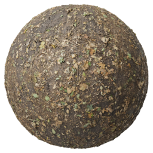</a> <b><a href="Ground023">Ground 023</a></b> by ambientCG · <a href="https://ambientcg.com/a/Ground023">source</a> | <a href="Ground024">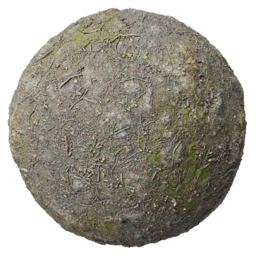</a> <b><a href="Ground024">Ground 024</a></b> by ambientCG · <a href="https://ambientcg.com/a/Ground024">source</a> | <a href="Ground025">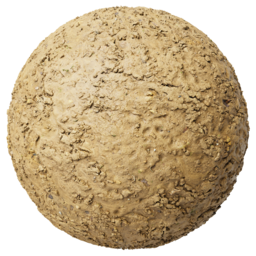</a> <b><a href="Ground025">Ground 025</a></b> by ambientCG · <a href="https://ambientcg.com/a/Ground025">source</a> | <a href="Ground026">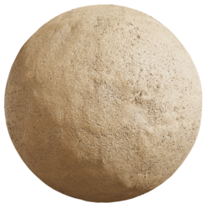</a> <b><a href="Ground026">Ground 026</a></b> by ambientCG · <a href="https://ambientcg.com/a/Ground026">source</a> |
| <a href="Ground027">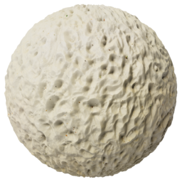</a> <b><a href="Ground027">Ground 027</a></b> by ambientCG · <a href="https://ambientcg.com/a/Ground027">source</a> | <a href="Ground028">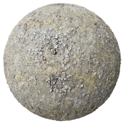</a> <b><a href="Ground028">Ground 028</a></b> by ambientCG · <a href="https://ambientcg.com/a/Ground028">source</a> | <a href="Ground029">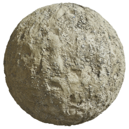</a> <b><a href="Ground029">Ground 029</a></b> by ambientCG · <a href="https://ambientcg.com/a/Ground029">source</a> | <a href="Ground030">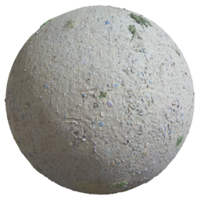</a> <b><a href="Ground030">Ground 030</a></b> by ambientCG · <a href="https://ambientcg.com/a/Ground030">source</a> |
| <a href="Ground031">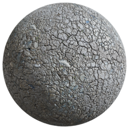</a> <b><a href="Ground031">Ground 031</a></b> by ambientCG · <a href="https://ambientcg.com/a/Ground031">source</a> | <a href="Ground032">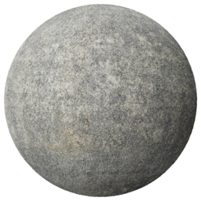</a> <b><a href="Ground032">Ground 032</a></b> by ambientCG · <a href="https://ambientcg.com/a/Ground032">source</a> | <a href="Ground033">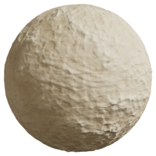</a> <b><a href="Ground033">Ground 033</a></b> by ambientCG · <a href="https://ambientcg.com/a/Ground033">source</a> | <a href="Ground034">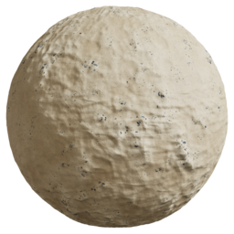</a> <b><a href="Ground034">Ground 034</a></b> by ambientCG · <a href="https://ambientcg.com/a/Ground034">source</a> |
| <a href="Ground035">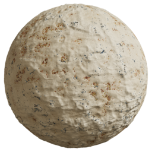</a> <b><a href="Ground035">Ground 035</a></b> by ambientCG · <a href="https://ambientcg.com/a/Ground035">source</a> | <a href="Ground036">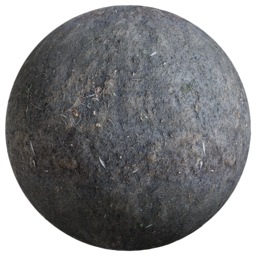</a> <b><a href="Ground036">Ground 036</a></b> by ambientCG · <a href="https://ambientcg.com/a/Ground036">source</a> | <a href="Ground037">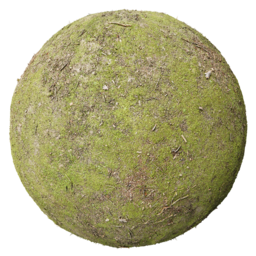</a> <b><a href="Ground037">Ground 037</a></b> by ambientCG · <a href="https://ambientcg.com/a/Ground037">source</a> | <a href="Ground038">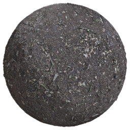</a> <b><a href="Ground038">Ground 038</a></b> by ambientCG · <a href="https://ambientcg.com/a/Ground038">source</a> |
| <a href="Ground039">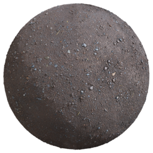</a> <b><a href="Ground039">Ground 039</a></b> by ambientCG · <a href="https://ambientcg.com/a/Ground039">source</a> | <a href="Ground040">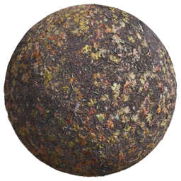</a> <b><a href="Ground040">Ground 040</a></b> by ambientCG · <a href="https://ambientcg.com/a/Ground040">source</a> | <a href="Ground041">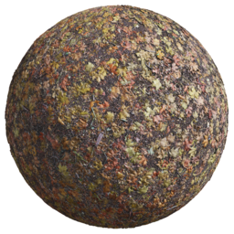</a> <b><a href="Ground041">Ground 041</a></b> by ambientCG · <a href="https://ambientcg.com/a/Ground041">source</a> | <a href="Ground042">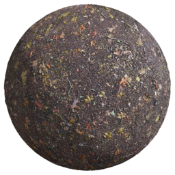</a> <b><a href="Ground042">Ground 042</a></b> by ambientCG · <a href="https://ambientcg.com/a/Ground042">source</a> |
| <a href="Ground043">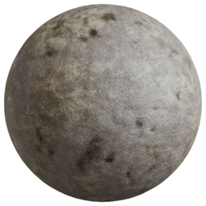</a> <b><a href="Ground043">Ground 043</a></b> by ambientCG · <a href="https://ambientcg.com/a/Ground043">source</a> |  |  |  |

---

Kept up to date by this repository's own [update workflow](.github/workflows/update.yml), with code and plan from [cc0-mirror](https://github.com/zuujis-cc0/cc0-mirror). Something wrong? [Open an issue there](https://github.com/zuujis-cc0/cc0-mirror/issues/new) or use the [private report form](https://games.zuujis.com/report).
